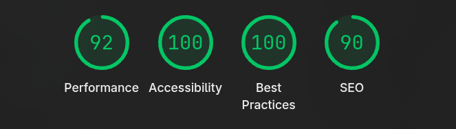

# cartographier le chaos

just a personal playground while I build out my blog site.

## current progress
- [x] navbar
- [x] footer

## running it locally

clone the repo and jump into the folder:
```bash
git clone <your-repo-url>
cd cartographier-le-chaos

```

install the dependencies and spin up the dev server:

```bash
pnpm install
pnpm dev

```

then just open up `http://localhost:3000` in your browser.

## Lighthouse Metrics
22/11/2026

Footer Inspo: [adxy](https://github.com/adxy/minima)
